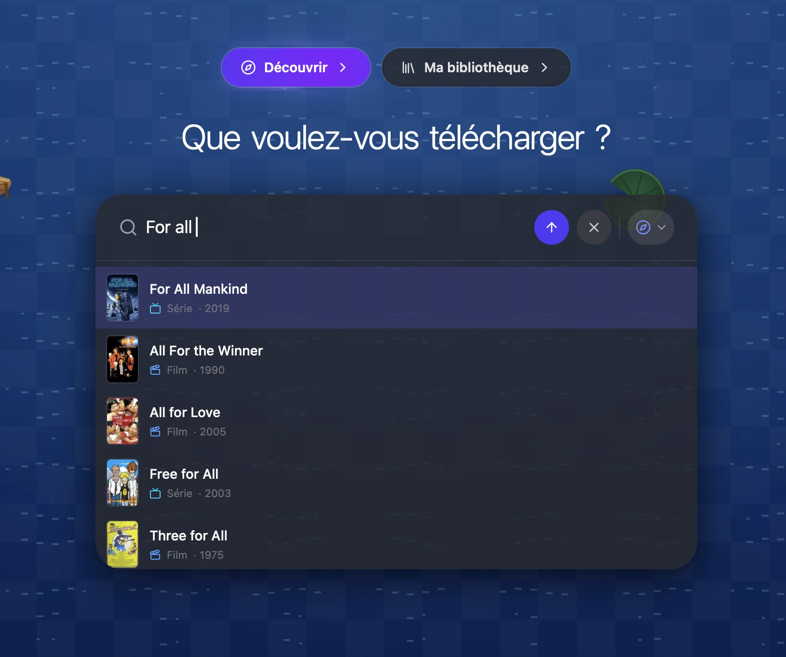
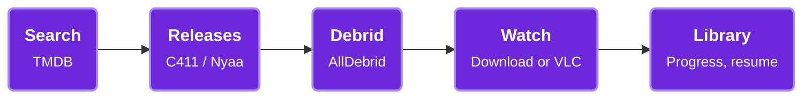
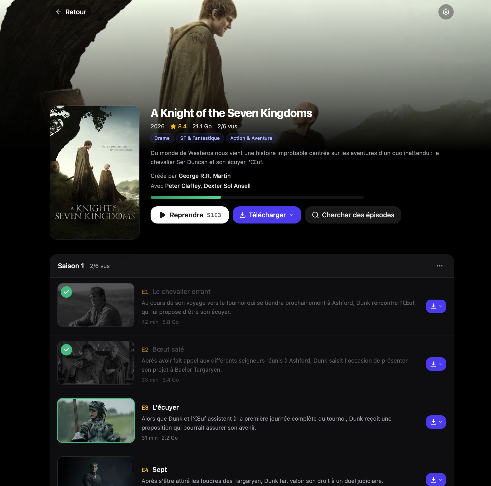
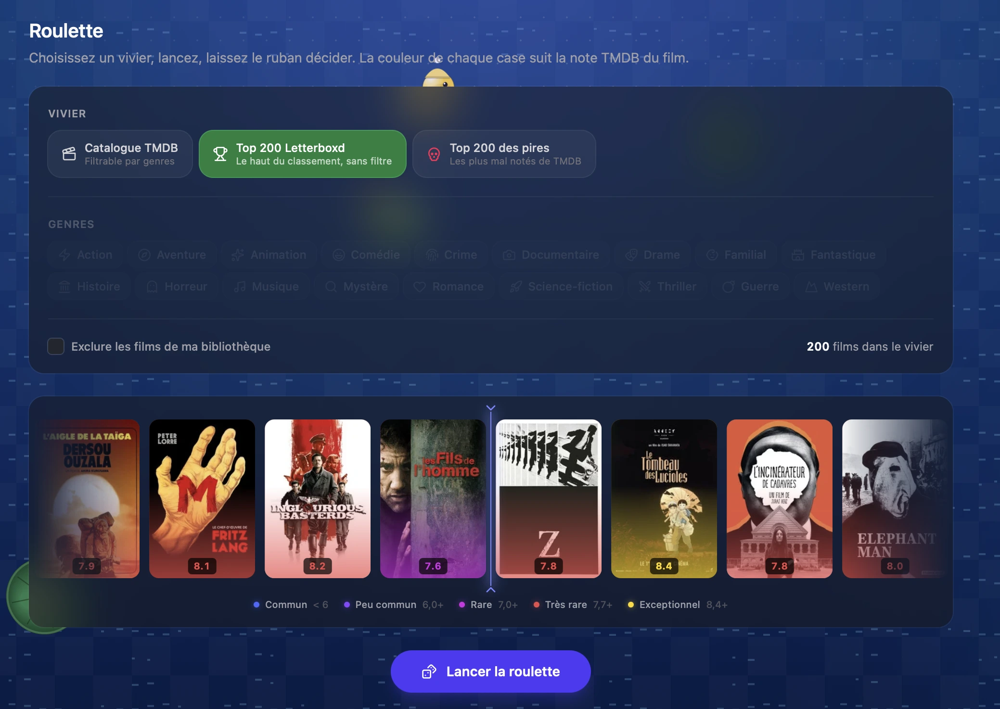

<div align="center">


# XingXing Debrid

**Search, debrid, download and watch. One desktop app, zero tab juggling.**

From a title in your head to a file in VLC: C411 or Nyaa search, AllDebrid link, native download, library tracking.

[](https://github.com/SylvainBoudacher/xingxing-debrid/releases/latest)


[](LICENSE)



<sub>The interface is in French.</sub>

</div>

---

## How it works



Type a movie, series, anime or manga. The app finds matching releases, parses quality, languages and seasons from the release names, sends the magnet to AllDebrid and hands you a direct link, a native download, or a stream straight into VLC.

## Features

<table>
  <tr>
    <td width="50%" valign="top">
      <h3>Search</h3>
      One central search bar with TMDB suggestions. Results from <b>C411</b> (movies, series) or <b>Nyaa</b> (anime), with filters on quality, language and full seasons, and a badge on what you already own.
    </td>
    <td width="50%" valign="top">
      <h3>Discover</h3>
      Trending titles and recommendations from TMDB, the Letterboxd and SensCritique tops, quick picks to grab the best release in one click, and a manga section.
    </td>
  </tr>
  <tr>
    <td valign="top">
      <h3>Downloads</h3>
      Track AllDebrid magnets in real time, download natively inside the app, and let series episodes sort themselves into <code>Series/Saison n</code> folders.
    </td>
    <td valign="top">
      <h3>Library</h3>
      A Netflix-style page per title: episode-by-episode progress, "Resume" straight into VLC, cast, recommendations, custom lists, drag-to-reorder and duplicate detection.
    </td>
  </tr>
  <tr>
    <td valign="top">
      <h3>Manga</h3>
      Search and download volumes, a dedicated manga library with covers and series pages, and a built-in CBZ reader.
    </td>
    <td valign="top">
      <h3>Movie roulette</h3>
      Can't decide? Pick a pool (TMDB by genre, Letterboxd Top 200, or the 200 worst), spin, and let the strip choose.
    </td>
  </tr>
</table>

<div align="center">
  
  
</div>

### The Duck Corner

Because a debrid client can have a pond. Ducks wander around the app, drop at random with rarities and shiny variants, and fill a collection dex. There is a shop, a slot machine, and a few easter eggs left to find.

### And also

- **Guided setup**: an animated welcome flow for your API keys (C411, AllDebrid, TMDB), VLC detection and a DNS guide
- **Secure storage**: API keys and session cookies live in the OS keyring, never in plain settings
- **Auto-updates**: in-app update check with release notes for every version
- **Profile import / export**: move your library and settings to another computer
- **Light, dark or system theme**, adjustable interface size and keyboard shortcuts
- **Built-in help** with troubleshooting and service status checks

## Install

Grab the latest build from the [Releases page](https://github.com/SylvainBoudacher/xingxing-debrid/releases/latest):

| Platform | File                                        |
| -------- | ------------------------------------------- |
| macOS    | `.dmg` (universal: Apple Silicon and Intel) |
| Windows  | `.exe` / `.msi` installer                   |

The app updates itself afterwards.

### What you need

- An [AllDebrid](https://alldebrid.com) account and API key
- A C411 account and its API key
- A [TMDB](https://www.themoviedb.org/settings/api) API key
- [VLC](https://www.videolan.org/vlc/) for streaming (optional)

## Development

**Prerequisites**: [Bun](https://bun.sh) and [Rust](https://rustup.rs) (stable toolchain).

```bash
git clone https://github.com/SylvainBoudacher/xingxing-debrid.git
cd xingxing-debrid
bun install
bun run tauri dev
```

| Command               | What it does                                           |
| --------------------- | ------------------------------------------------------ |
| `bun run tauri dev`   | Full app (Tauri + Vite with HMR)                       |
| `bun run dev`         | Frontend only, in a plain browser                      |
| `bun run tauri build` | Production build in `src-tauri/target/release/bundle/` |
| `bun run test`        | Unit tests (Vitest)                                    |
| `bun run lint`        | ESLint                                                 |
| `bunx tsc --noEmit`   | Type check                                             |

**Browser preview**: `bun run dev` works without the native shell. Copy `.env.example` to `.env.local` and fill the `VITE_DEV_*` keys; storage falls back to localStorage and HTTP to native `fetch`.

Releases are described in [RELEASING.md](RELEASING.md) and [VERSIONING.md](VERSIONING.md).

### Tech stack

| Layer        | Technology                                              |
| ------------ | ------------------------------------------------------- |
| UI           | React 19, TypeScript, Tailwind CSS 4, shadcn/ui, Motion |
| Data         | TanStack Query                                          |
| Native shell | Tauri 2 (Rust), keyring, updater                        |
| Build        | Vite, Bun                                               |
| Tests        | Vitest, ESLint, Prettier                                |

### Project structure

```
src/
  pages/            Search, Discover, Library, Magnets, Reader, Settings, Setup, Help
  components/       UI building blocks (shadcn/ui in components/ui)
  lib/              API services, release parsing, library, manga, ducks
src-tauri/
  src/lib.rs        Tauri commands (Rust backend)
  tauri.conf.json   App configuration
```

## Disclaimer

This software is provided for personal and educational use only. It is a client that talks to third-party services (AllDebrid, C411, Nyaa, TMDB) through their standard interfaces.

- The author is not responsible for how you use this application.
- You are solely responsible for complying with the terms of service of any third-party service you access through it.
- You are solely responsible for complying with the laws applicable in your country.
- This project does not host, distribute or reproduce any copyrighted content.

## License

[MIT](LICENSE) - Sylvain Boudacher
